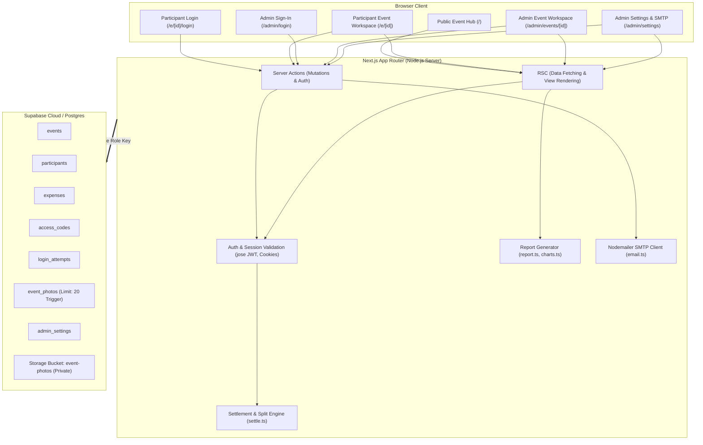
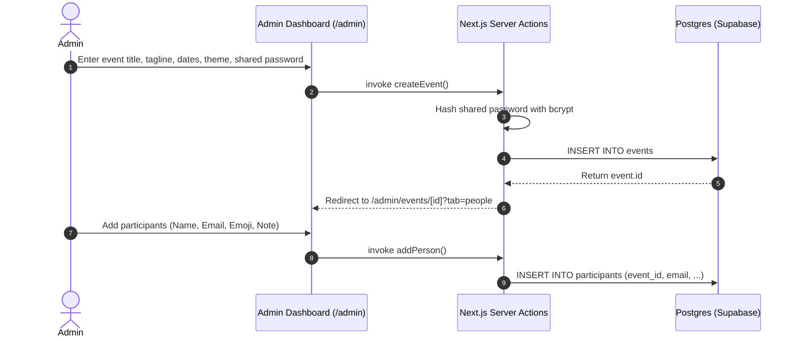
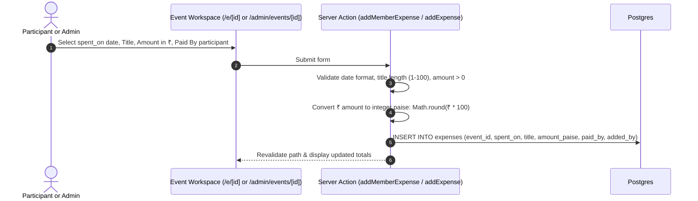
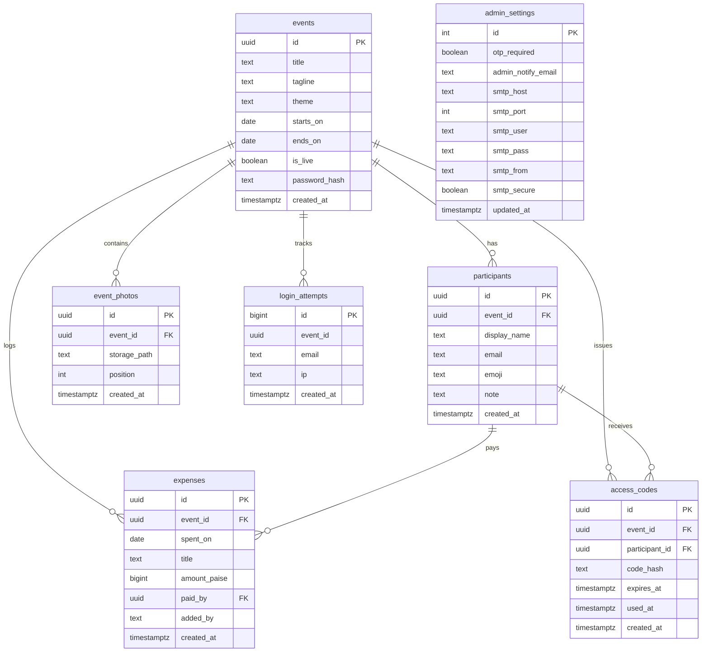

# Event Splitter — System Architecture & Technical Specifications

> **Audience:** Developers, Architects, AI Agents, and Product Owners.  
> **Purpose:** Comprehensive, single-source-of-truth reference explaining the end-to-end architecture, domain models, security boundaries, settlement algorithms, and UI systems of **Event Splitter**.

---

## 1. Executive Summary

**Event Splitter** is a web application tailored for friend groups to track collective spending during events, trips, and celebrations (e.g., festivals, weekend getaways, parties). It calculates equal splits without floating-point error, determines an optimal settlement path (*"who pays whom"*), provides an exportable HTML report with charts, and presents a dynamic gallery with rotating blurred backdrops.

### Key Distinctives
1. **Dual Role Architecture:**
   - **Admin Workspace:** Full control to create events, manage participants, issue login codes, toggle OTP enforcement, manage expenses, upload up to 20 photos, view spending analytics, and export HTML reports.
   - **Participant Portal:** Event-scoped access using the participant's email, the event's shared password, and an admin-issued single-use 6-digit code (or direct access if OTP is disabled). Participants can log date-wise expenses, view live balances, and check settlement obligations.
2. **Deterministic Settlement Algorithm:** All calculations run on integer paise (1 INR = 100 paise) with zero rounding drift, distributing any remaining paise systematically and computing the minimal number of peer-to-peer transfers via a greedy algorithm.
3. **Festive Theme Engine:** High-energy, colorful aesthetic inspired by celebration motifs (Lantern, Marigold, Bonfire, Kite, Gulal, Midnight) without naming specific countries. Features client-side SVG artwork and a rotating low-opacity blurred background fed by the event's photo gallery.
4. **Hardened Security & Zero Public Supabase Access:** Complete RLS lockdown on all tables (`revoke all from anon, authenticated`). All database and storage operations execute server-side via Supabase's `service_role` key following rigorous Next.js server authentication.

---

## 2. High-Level System Architecture



---

## 3. Technology Stack & Runtime

| Layer | Technology | Rationale |
|---|---|---|
| **Framework** | Next.js 16 (App Router) | React Server Components for instant load speeds, zero client-bundle bloat, server-side data fetching, and native Server Actions. |
| **Language** | TypeScript 5 (Strict Mode) | Full type-safety across database models, financial calculations, themes, and server actions. |
| **Database** | PostgreSQL 15+ (via Supabase) | Relational constraints, foreign keys with cascade deletions, unique composite indexes, and transactional PL/pgSQL triggers. |
| **File Storage** | Supabase Storage (`event-photos`) | Private bucket with restricted mime-types (`image/jpeg`, `image/png`, `image/webp`), 4 MB file limit, and 1-hour signed URLs. |
| **Styling** | Vanilla CSS (`src/app/globals.css`) | Semantic CSS tokens, responsive flex/grid layouts, no external UI library runtime cost, high performance. |
| **Cryptography & Sessions** | `bcryptjs` + `jose` | Secure password hashing (salt rounds: 10) and stateless signed `httpOnly` JWT session cookies for participants. |
| **Email Delivery** | Nodemailer | Direct SMTP dispatch for sending admin-generated OTPs and system test emails. |
| **Testing** | Vitest 5 | Unit tests for financial settlement math, report generation, and CoverArt visual components. |

---

## 4. End-to-End Workflows

### 4.1 Admin Lifecycle & Event Creation


### 4.2 Participant Login & OTP Authentication
```mermaid
sequenceDiagram
    autonumber
    actor Participant
    actor Admin
    participant UI as Event Login (/e/[id]/login)
    participant Server as Next.js Server Actions
    participant DB as Postgres
    participant SMTP as Admin Email / SMTP

    Note over Participant,UI: Step 1: Participant visits event
    Participant->>UI: Selects live event from Hub (/) -> /e/[id]/login

    alt Admin Issues Code Manually
        Admin->>Server: Click "Issue login code" in Admin Workspace
        Server->>Server: Generate 6-digit random code, SHA-256 hash
        Server->>DB: INSERT INTO access_codes (hash, expires_at: +30m)
        Server-->>Admin: Display plain code ONCE (or sends via SMTP)
        Admin->>Participant: Shares code via WhatsApp / SMS / Email
    else Automated Email Dispatch
        Participant->>UI: Requests OTP code via "Send OTP to Admin"
        UI->>Server: invoke requestOtpAction()
        Server->>SMTP: Sends 6-digit OTP to admin_notify_email
    end

    Note over Participant,UI: Step 2: Sign-in verification
    Participant->>UI: Inputs: Email + Shared Event Password + 6-Digit OTP
    UI->>Server: invoke memberLogin()
    Server->>DB: Check rate limits (login_attempts < 5 per email/15 min)
    Server->>DB: Verify event.password_hash with bcrypt
    alt OTP Required in Admin Settings
        Server->>DB: Verify access_codes (hash match, expires_at > now, used_at is NULL)
        Server->>DB: UPDATE access_codes SET used_at = now()
    end
    Server->>Server: Issue signed JWT cookie: event_member_[id]
    Server-->>UI: Set-Cookie (HttpOnly, Secure, SameSite=Lax, 7-day maxAge)
    UI-->>Participant: Redirect to /e/[id]
```

### 4.3 Adding Expenses & Date-Wise Tracking


---

## 5. Settlement Algorithm & Mathematical Model

All monetary calculations in Event Splitter use integer **paise** ($1\text{ INR} = 100\text{ paise}$) to guarantee exact calculations without JavaScript floating-point binary rounding errors (e.g., `0.1 + 0.2 !== 0.3`).

### 5.1 Fair Share Calculation
Given an event with total expenditure $T$ in paise and $N$ registered participants:
$$\text{Base Share} = \lfloor T / N \rfloor$$
$$\text{Remainder Paise } R = T \pmod N$$
The remainder $R$ is distributed by assigning $+1$ paisa to the first $R$ participants (sorted deterministically by ID). Therefore:
$$\sum_{i=1}^{N} \text{Share}_i = T$$

### 5.2 Net Balance Calculation
For each participant $i$:
$$\text{Net Balance}_i = \text{Total Paid}_i - \text{Share}_i$$
- If $\text{Net Balance}_i > 0$: Participant is a **Creditor** (is owed money).
- If $\text{Net Balance}_i < 0$: Participant is a **Debtor** (owes money).
- If $\text{Net Balance}_i = 0$: Participant is **Settled**.

### 5.3 Minimal Debt Settlement (Greedy Algorithm)
To settle debts with the minimum number of transactions:
1. Segregate participants into two priority queues:
   - **Debtors** ordered descending by debt amount ($|\text{Net Balance}|$).
   - **Creditors** ordered descending by credit amount ($\text{Net Balance}$).
2. Match the largest debtor with the largest creditor:
   $$\text{Transfer Amount} = \min(\text{Debtor Debt}, \text{Creditor Credit})$$
3. Deduct the transfer amount from both parties.
4. If either party's remaining balance is $> 0$, re-insert them into their respective queue.
5. Repeat until all balances reach 0.

#### Formal Example (Arun & Rahul Test Case):
- **Participants (5):** Rekha, Arun, Rahul, Nikita, Viren ($N=5$)
- **Expenses:**
  - Pizza: ₹400.00 (40,000 paise), paid by Arun
  - Mazza: ₹35.00 (3,500 paise), paid by Rahul
  - **Total $T$:** ₹435.00 (43,500 paise)
- **Share per person:** $43,500 / 5 = 8,700\text{ paise}$ (₹87.00)
- **Net Balances:**
  - Arun: $+40,000 - 8,700 = +31,300\text{ paise}$ (+₹313.00) [Creditor]
  - Rahul: $+3,500 - 8,700 = -5,200\text{ paise}$ (-₹52.00) [Debtor]
  - Rekha: $0 - 8,700 = -8,700\text{ paise}$ (-₹87.00) [Debtor]
  - Nikita: $0 - 8,700 = -8,700\text{ paise}$ (-₹87.00) [Debtor]
  - Viren: $0 - 8,700 = -8,700\text{ paise}$ (-₹87.00) [Debtor]
- **Settlement Transactions Generated:**
  1. Rekha pays Arun ₹87.00
  2. Nikita pays Arun ₹87.00
  3. Viren pays Arun ₹87.00
  4. Rahul pays Arun ₹52.00
  - **Total Received by Arun:** $87 + 87 + 87 + 52 = \text{₹313.00}$. **All accounts settled in 4 transfers.**

---

## 6. Database Schema & RLS Policies

All tables reside in the `public` schema in PostgreSQL with Row Level Security enabled and public grants revoked.



### Critical Database Constraints & Triggers
- **20-Photo Cap Trigger:** `enforce_photo_limit()` executes before insert on `event_photos`. Uses an advisory transaction lock (`pg_advisory_xact_lock(hashtext(new.event_id::text))`) to ensure race-condition immunity.
- **Unique Participant Per Event:** `UNIQUE (event_id, email)` prevents duplicate registrations.
- **Participant Deletion Guard:** `expenses.paid_by` has foreign key constraint `ON DELETE RESTRICT`, preventing accidental deletion of participants who have recorded payments.

---

## 7. Frontend Design System & Theme Engine

### 7.1 Visual Philosophy
The design avoids sterile spreadsheet UI. It implements an energetic, celebratory aesthetic ("Ganzy" festive styling) characterized by:
- Deep jewel tones paired with warm parchment highlights.
- Glassmorphism cards with subtle border halos.
- Dynamic SVG bunting, lanterns, and themed festive hero art.
- Animated rotating blurred background derived from real event gallery photos.

### 7.2 Theme Definitions
Defined in `src/lib/themes.ts`:
| Theme Key | Visual Theme | Dominant Hues | Best Suited For |
|---|---|---|---|
| `lantern` | Golden Lantern Glow | Amber, Crimson, Gold (`#e0531c`, `#f59e0b`) | Night parties, diwali-style lights |
| `marigold` | Fresh Marigold Florals | Marigold Yellow, Tangerine, Leaf Green (`#e67e22`, `#27ae60`) | Daytime get-togethers, weddings |
| `bonfire` | Campfire & Night Sparks | Deep Orange, Fire Ruby, Charcoal (`#d35400`, `#c0392b`) | Camping, outdoor barbecues |
| `kite` | Sky Carnival & Kites | Azure, Magenta, Sunshine Yellow (`#2980b9`, `#8e44ad`) | Beach trips, spring celebrations |
| `gulal` | Powder Color Carnival | Vibrant Violet, Neon Pink, Bright Yellow (`#9b59b6`, `#e91e63`) | Holi style parties, music festivals |
| `midnight` | Midnight Celebration | Indigo, Violet, Electric Cyan (`#2c3e50`, `#16a085`) | New Year's Eve, late-night dinners |

---

## 8. Directory & File Structure

```
d:/Learning/event-splitter/
├── .env.example                     # Reference environment variables
├── DEPLOYMENT_GUIDE.md              # Step-by-step deployment to Vercel + Supabase
├── PROJECT_ARCHITECTURE.md          # [This Document] End-to-end technical guide
├── PROJECT_UPDATE_REFERENCE.md      # Date-wise development and changelog history
├── TASK_LIST.md                     # Roadmap, sprint backlog, and active tasks
├── TASK_LOG.md                      # Operational activity log of all executed tasks
├── package.json                     # Dependencies and scripts
├── vitest.config.ts                 # Vitest test runner configuration
├── scripts/
│   └── seed.mjs                     # Seeds demo event (Pizza & Mazza Arun/Rahul case)
├── supabase/
│   └── schema.sql                   # Complete SQL schema, RLS policies, trigger & bucket
└── src/
    ├── app/
    │   ├── globals.css              # Universal design tokens and responsive stylesheet
    │   ├── layout.tsx               # Root HTML wrapper and global metadata
    │   ├── page.tsx                 # Public Live Event Hub
    │   ├── admin/
    │   │   ├── actions.ts           # Admin event management & sign-out actions
    │   │   ├── page.tsx             # Admin Master Dashboard (all events view)
    │   │   ├── login/               # Supabase admin authentication page
    │   │   ├── settings/            # OTP mode toggle & SMTP configuration
    │   │   └── events/[id]/         # Admin Event Workspace (Dashboard, Expenses, People, Gallery, Reports)
    │   ├── api/
    │   │   └── admin/events/[id]/
    │   │       ├── photos/route.ts  # Multipart photo upload API (limit 20, 4MB)
    │   │       └── report/route.ts  # Downloadable standalone HTML report endpoint
    │   └── e/[id]/                  # Participant Event View
    │       ├── actions.ts           # Member login, logout, add expense, request OTP
    │       ├── page.tsx             # Participant expense list, settlement view & gallery
    │       └── login/page.tsx       # Participant event-scoped login form
    ├── components/
    │   ├── Backdrop.tsx             # Blurred rotating backdrop using gallery photos
    │   ├── Chart.tsx                # Client-safe SVG chart wrapper
    │   ├── CopyButton.tsx           # Interactive copy-to-clipboard button
    │   ├── CoverArt.tsx             # Parametric procedural SVG festive artwork
    │   ├── Gallery.tsx              # Event photo gallery grid with lightbox modal
    │   └── ui.tsx                   # Reusable components: Stat, Flash, ExpenseForm
    └── lib/
        ├── auth-admin.ts            # Supabase server admin identity verification
        ├── charts.ts                # Zero-dependency SVG bar, donut & pair charts
        ├── email.ts                 # Nodemailer client and OTP email templating
        ├── event-data.ts            # Data loaders aggregating events, people & expenses
        ├── money.ts                 # Currency formatters (₹ INR, date strings)
        ├── report.ts                # Standalone HTML report generator with embedded SVGs
        ├── session.ts               # Participant JWT session management via jose
        ├── settings.ts              # System settings & SMTP credential queries
        ├── settle.ts                # Integer paise split and greedy settlement algorithm
        ├── themes.ts                # Theme color palettes and metadata
        ├── types.ts                 # TypeScript types and domain interfaces
        └── validate.ts              # Input validators (UUID, emails, strings)
```

---

## 9. Security & Access Control Matrix

| Resource | Public Guest | Participant (Logged In) | Admin (`ADMIN_EMAIL`) |
|---|---|---|---|
| **Live Event Hub (`/`)** | View title, tagline, dates, participant count | View | View |
| **Participant Sign-In (`/e/[id]/login`)** | Submit email + password + OTP | Already signed in | Can view / test |
| **Participant View (`/e/[id]`)** | ❌ Blocked (redirects to login) | View expenses, balances, gallery | Full access |
| **Add Expense in Event** | ❌ Blocked | ✅ Allowed (marked `added_by: participant`) | ✅ Allowed (marked `added_by: admin`) |
| **Delete / Edit Expenses** | ❌ Blocked | ❌ Blocked | ✅ Allowed |
| **View Event Gallery** | ❌ Blocked | ✅ Allowed (1-hour signed URLs) | ✅ Allowed |
| **Upload Photos (Max 20)** | ❌ Blocked | ❌ Blocked | ✅ Allowed |
| **Issue Participant OTP** | ❌ Blocked | ❌ Blocked | ✅ Allowed (manual copy or SMTP) |
| **Toggle OTP / Edit SMTP** | ❌ Blocked | ❌ Blocked | ✅ Allowed (`/admin/settings`) |
| **Download HTML Report** | ❌ Blocked | ✅ Read-only HTML report view | ✅ Full download & view |
| **Database Direct API Access** | ❌ Revoked | ❌ Revoked | ❌ Revoked (Service Role on server only) |

---

## 10. Verification & Quality Gates

Every code change must satisfy three gates before release:
1. **Automated Unit Testing:**
   ```bash
   npm test
   ```
   Validates settlement edge cases (uneven remainders, single payer, all zero, Arun & Rahul scenario), SVG CoverArt generation, and HTML report compilation.
2. **TypeScript Compilation:**
   ```bash
   npm run typecheck
   ```
   Ensures strict type-safety with 0 errors across server components, actions, and API routes.
3. **Database Guardrails:**
   All tables must have active RLS. Photos must never exceed 20 per event. Passwords must never be stored in plain text.
